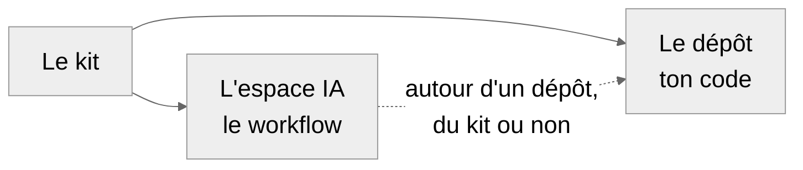

# kit-projet

Un gabarit pour démarrer un projet de code propre, et le mener avec une IA sans en perdre le contrôle.

## À quoi ça sert

Le kit fournit deux briques, à prendre ensemble ou séparément.

- **Le dépôt** : en une commande, le dépôt git d'un projet déjà prêt, avec tests, vérifications
  automatiques, règles pour l'agent de code et modèles de documents. Quand le kit évolue, tes projets se
  mettent à jour sans perdre tes modifications.
- **L'espace IA** : un dossier de travail à côté du dépôt. Des conversations d'IA séparées y conçoivent le
  travail, puis relisent celui de l'agent de code. Il s'installe aussi autour d'un dépôt qui existe
  déjà, perso ou de groupe, sur GitHub, sur une autre forge ou seulement sur ta machine.

**Pour qui ?** Tu sais programmer, et tu débutes sur git ou sur les agents de code. Le dépôt est outillé
pour Python ; l'espace IA marche avec n'importe quel langage. Le kit marche sous Windows, macOS et Linux,
avec Claude ou un autre agent.

## Le principe



Le **dépôt** contient ton code et tout ce qui le vérifie. L'**espace IA** accueille les conversations de
conception et de relecture ; il entoure un dépôt, généré par le kit ou non. Pour un petit projet, le dépôt
seul suffit. Pour mener avec cette méthode un projet qui existe déjà, ou tes tâches dans un projet de
groupe, l'espace seul suffit.

## Démarrer sans prise de tête

Tu as Claude Code, ou un autre agent de code ? Ouvre une session neuve dans le dossier où tu ranges tes
projets, et colle ce message. L'agent lit le kit, te pose ses questions, t'explique les mots et te dit
si le kit t'aidera vraiment. Avec ton accord, il lance les commandes à ta place.

```text
Je veux peut-être démarrer un projet avec kit-projet, ou mener avec lui un projet qui existe déjà :
https://github.com/rdwk2/kit-projet

Clone ce dépôt dans un dossier temporaire, puis lis README.md, docs/GUIDE.md, docs/WORKFLOW.md et
docs/GLOSSAIRE.md.

Ensuite, avant de lancer quoi que ce soit :
1. Demande-moi ce que je veux faire, si le projet a déjà un dépôt, si je travaille seul ou à plusieurs,
   et ce que je connais déjà de git et des agents. Une question à la fois.
2. Dis-moi franchement si le kit m'aidera pour ce projet, et lesquelles de ses deux briques (le dépôt,
   l'espace IA) me servent. Propose un préréglage et explique-le avec des mots simples.
3. Vérifie ce qui est installé sur ma machine (git, uv, just, gh), et dis-moi ce qui manque.

Puis, avec mon accord, lance toi-même les commandes du guide et vérifie leur résultat. Termine en me
disant ce que je fais ensuite, avec la première demande à faire à mon agent.
```

## Démarrer à la main, en dix minutes

Ces étapes créent un **petit projet** : le dépôt seul, avec le préréglage solo léger. Pour un autre
préréglage, voir [plus bas](#quel-préréglage-choisir).

**1. Installe les outils**, une seule fois. Il te faut [git](https://git-scm.com/downloads), un
compte [GitHub](https://github.com), puis uv et just :

```bash
# macOS et Linux
curl -LsSf https://astral.sh/uv/install.sh | sh
```

```powershell
# Windows, dans PowerShell
powershell -ExecutionPolicy ByPass -c "irm https://astral.sh/uv/install.ps1 | iex"
```

Rouvre ton terminal, puis :

```bash
uv tool install rust-just
```

**2. Crée ton projet.** Place-toi dans le dossier où tu ranges tes projets. `mon-projet` est un
exemple : **remplace-le par le nom de ton projet**, en minuscules, sans espace ni accent. Copier, l'outil
qui génère le projet, pose ensuite quelques questions ; garde les réponses proposées si tu hésites.

```bash
# À remplacer : mon-projet
uvx copier copy --data couche=depot --data preset=solo-leger gh:rdwk2/kit-projet mon-projet
```

**3. Vérifie que tout est vert.**

```bash
# À remplacer : mon-projet
cd mon-projet
git init -b main
uv sync
just check
```

**4. Enregistre ce premier état.** `uv.lock` part dans ce commit : sans lui, la vérification de GitHub
échouerait.

```bash
git add -A
git commit -m "chore: squelette depuis kit-projet"
```

**5. Mets-toi au travail.** Ouvre ton agent de code dans le dossier de ton projet. Il lit `CLAUDE.md`
(ou `AGENTS.md`), qui lui donne les règles du projet. Tu peux commencer par ce message :

```text
Lis CLAUDE.md. Pose-moi des questions sur ce que je veux faire, une à la fois, puis complète README.md
et docs/ROADMAP.md. Propose ensuite un plan pour le premier jalon, et attends mon accord avant d'écrire
du code.
```

Pour envoyer le projet sur GitHub et protéger `main` : [guide](docs/GUIDE.md#4-après-la-génération).

## Quel préréglage choisir

Le préréglage se choisit dans la commande de l'étape 2, avec `preset=`.

| Préréglage | Pour | Ce que tu génères | `preset=` |
|---|---|---|---|
| **Solo léger** | Un TP, un script, un petit outil | Le dépôt | `solo-leger` |
| **Groupe scolaire** | Un projet à plusieurs, débutants sur GitHub | Le dépôt, avec un guide pour les camarades | `groupe-scolaire` |
| **Standard** | Un projet personnel qui dure | Le dépôt et l'espace IA, avec conception et relectures | `perso-standard` |
| **Complet** | Un gros projet, avec des données privées | Le standard, plus archives, mutation et passes expertes | `perso-complet` |

Standard et Complet demandent deux commandes, car ils génèrent aussi l'espace IA : voir le
[guide, § 3.2](docs/GUIDE.md#32-le-dépôt-et-lespace-ia).

## L'espace IA autour d'un projet existant

Ton projet a déjà son dépôt ? L'espace s'installe à côté, sans rien écrire dedans. Copier demande ce que
le dépôt a déjà : sa branche principale, les règles de ton agent, la commande qui le vérifie, ses documents.
Les textes de l'espace citent alors tes fichiers à toi.

```bash
# À remplacer : mon-projet-ia
uvx copier copy --data couche=espace --data origine=existant gh:rdwk2/kit-projet mon-projet-ia
```

- **Dans un projet de groupe**, ajoute `--data role=membre` : l'espace ne couvre que les tâches qui te sont
  confiées, et les responsables du dépôt fusionnent.
- **Sans GitHub** (autre forge, ou dépôt seulement sur ta machine), ajoute `--data forge=git`.

Le détail : [guide, § 3.3](docs/GUIDE.md#33-greffer-lespace-sur-un-dépôt-existant).

## Pour aller plus loin

- [Le guide](docs/GUIDE.md) : créer, mettre en route, mettre à jour un projet, cas particuliers.
- [Le workflow A/B/C expliqué](docs/WORKFLOW.md) : à quoi servent les conversations séparées.
- [Le glossaire](docs/GLOSSAIRE.md) : les mots du kit et de git.
- [Contribuer](CONTRIBUTING.md) : ta propre version du kit, ou une amélioration à proposer.

## Licence

[MIT](LICENSE). Les fichiers que le kit génère t'appartiennent : tu n'as aucune mention à y garder.
