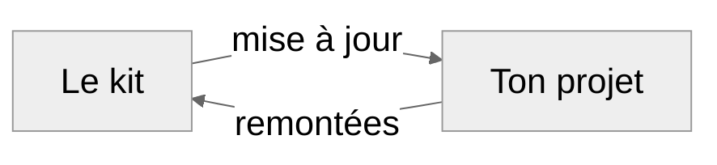

# Guide

Ce guide reprend tout ce que le [démarrage rapide](../README.md) laisse de côté. Les commandes
marchent sous Windows (PowerShell), macOS et Linux, sauf mention contraire. Un mot inconnu ? Voir le
[glossaire](GLOSSAIRE.md).

**À remplacer.** `mon-projet` est un exemple : remplace-le par le nom de ton projet, en minuscules, sans
espace ni accent. Tout texte entre `«…»` est à remplacer aussi, guillemets compris. Chaque bloc de
commandes rappelle ce qu'il faut remplacer sur sa première ligne.

## 1. Ce qu'il te faut

| Outil | À quoi il sert | Installation |
|---|---|---|
| git | L'historique du projet | [git-scm.com](https://git-scm.com/downloads) ; macOS : `xcode-select --install` |
| uv | Installe Python et les dépendances du projet | [docs.astral.sh/uv](https://docs.astral.sh/uv/getting-started/installation/) |
| Copier | Génère ton projet à partir du kit, et le met à jour | Rien à faire : `uvx copier …` le télécharge à la volée |
| just | Les commandes du projet | `uv tool install rust-just` |
| Un compte GitHub | Héberger le dépôt, faire tourner la CI | [github.com](https://github.com) |
| gh | GitHub en ligne de commande. Obligatoire pour l'espace IA, pratique sinon | [cli.github.com](https://cli.github.com), puis `gh auth login` |
| Un agent de code | Écrire le code | Claude Code, Codex, Copilot… |

## 2. Choisir un préréglage

Le préréglage choisit les modules : les fonctions que le kit ajoute. Tu pourras en ajouter plus tard (§ 6).

| Module | Couche | Ce qu'il ajoute | Solo léger | Groupe scolaire | Standard | Complet |
|---|---|---|:-:|:-:|:-:|:-:|
| *socle du dépôt* | dépôt | `CLAUDE.md`, `AGENTS.md`, `README.md`, `BACKLOG.md`, `docs/` | ✓ | ✓ | ✓ | ✓ |
| *Python* (question « langage ») | dépôt | uv, just, ruff, mypy, pytest, CI : `just check` vert dès la génération | ✓ | ✓ | ✓ | ✓ |
| `groupe` | dépôt | `CONTRIBUTING.md` pour débutants, modèle de PR, livraisons par tags ; le `JOURNAL` s'écrit à chaque livraison, pas à chaque PR | | ✓ | | |
| `donnees-privees` | dépôt | Données hors du dépôt, protégées de Claude Code par un hook | | | | ✓ |
| `analyse-donnees` | dépôt | Pour un projet qui analyse des données : une charte (les règles que l'analyse s'impose avant de commencer) et la liste des questions posées aux données | | | | à cocher |
| *socle de l'espace IA* | espace IA | Le minimum pour une conversation de conception : son dossier, ses scripts, ses modèles de documents | facultatif | facultatif | ✓ | ✓ |
| `relectures` | espace IA | Les relectures B et C | | | ✓ | ✓ |
| `archives` | espace IA | Archives de la conception | | | | ✓ |
| `mutation` | espace IA | Vérifier que les tests détectent une erreur | | | | ✓ |
| `expert` | espace IA | Passes expertes et sessions à part | | | | ✓ |
| `pistes` | espace IA | Plusieurs axes de travail sur le même dépôt (§ 5) | | | ✓ | ✓ |

**Solo léger et Groupe scolaire reçoivent un dépôt allégé** : un `CLAUDE.md` plus court, `mypy` en mode
souple, et les tests de propriété facultatifs (`uv add --dev hypothesis` les ajoute). Standard et Complet
gardent les règles complètes et `mypy` strict. Pour durcir un projet : `strict = true` dans
`pyproject.toml`.

**En solo léger et en groupe scolaire, ne génère pas l'espace IA.** Il pèse une trentaine de fichiers
qu'un débutant n'a pas à lire. Dans un groupe, les camarades n'ont besoin que du dépôt.

Dans les commandes, « Standard » s'écrit `perso-standard`, et « Complet », `perso-complet`.

## 3. Créer un projet

**Suis le § 3.1, le § 3.2 ou le § 3.3, un seul.** Le § 3.1 sert à un petit projet ou à un projet de
groupe ; le § 3.2 aux préréglages Standard et Complet ; le § 3.3 à un projet qui a déjà son dépôt.

### 3.1 Le dépôt seul

Place-toi dans le dossier où tu ranges tes projets. Choisis un dossier court, sans espace ni accent :
sous Windows, les chemins longs posent problème. Ici, ce dossier s'appelle `dev`, dans ton dossier
personnel ; `mkdir` le crée s'il n'existe pas.

```bash
# À remplacer : ~/dev si tu ranges tes projets ailleurs, mon-projet, et solo-leger si besoin
mkdir -p ~/dev
cd ~/dev
uvx copier copy --data couche=depot --data preset=solo-leger gh:rdwk2/kit-projet mon-projet
```

Copier pose les questions une à une, avec une aide pour chacune. Il prend la dernière version du kit.

### 3.2 Le dépôt et l'espace IA

Ici, on génère deux choses, et le dépôt se trouve **dans** l'espace IA. Le plus simple est de préparer
les réponses une fois pour les deux. Voici où tout se range à la fin :

```text
~/dev/                           ton dossier de projets : tu lances les commandes ici
├── mon-projet.yml               ton fichier de réponses
└── mon-projet/                  l'espace IA, créé par la première commande
    ├── 00_LISEZ_MOI_ESPACE.md   commence par là
    ├── conception/              A seule
    ├── v_for_cowork/            A et ses relecteurs
    ├── relecture/               les postes de C
    ├── outils/                  les scripts
    └── mon-projet/              le dépôt, créé par la seconde commande
```

1. Télécharge [`outils_kit/reponses_exemple.yml`](../outils_kit/reponses_exemple.yml) depuis GitHub
   (bouton *Download raw file*).
2. Enregistre-le dans ton dossier de projets, sous le nom `mon-projet.yml`, en mettant le nom de ton projet.
3. Ouvre-le et remplis-le. Ce qui manque sera demandé.
4. Lance les deux commandes depuis ton dossier de projets :

```bash
# À remplacer : ~/dev, et mon-projet à chaque fois (deux fois dans la 1re commande, trois dans la 2e)
cd ~/dev
uvx copier copy --data-file mon-projet.yml --data couche=espace gh:rdwk2/kit-projet mon-projet
uvx copier copy --data-file mon-projet.yml --data couche=depot gh:rdwk2/kit-projet mon-projet/mon-projet
```

Ton fichier de réponses est ailleurs ? Copie son chemin, et mets-le à la place de `mon-projet.yml` dans
les deux commandes. Sous Windows : sélectionne le fichier et fais `Ctrl+Maj+C`. Sous macOS : `Option` et
clic droit, *Copier en tant que nom de chemin*. Dans VS Code : clic droit, *Copy Path*.

Avec `--defaults`, Copier ne pose aucune question : une question sans valeur par défaut (`humain`,
`github`) échoue alors, sauf si elle est dans le fichier de réponses ou dans tes réglages (§ 7).

### 3.3 Greffer l'espace sur un dépôt existant

Ton projet a déjà son dépôt, perso ou de groupe, fait sans le kit ? L'espace IA s'installe à côté,
**sans rien écrire dans ton dépôt**. Il faut seulement que le dépôt soit sur GitHub et que tu en aies une
copie de travail sur ta machine.

```text
~/dev/
├── mon-projet/        ton dépôt, tel qu'il est : la copie de travail de l'agent de code
└── mon-projet-ia/     l'espace IA, créé par la commande ci-dessous
```

```bash
# À remplacer : ~/dev et mon-projet-ia
cd ~/dev
uvx copier copy --data couche=espace --data origine=existant gh:rdwk2/kit-projet mon-projet-ia
```

Copier pose ses questions. Trois réponses comptent ici :

- **le dossier de l'espace** (`racine`) : celui que crée la commande, ici `~/dev/mon-projet-ia` ;
- **la copie de travail** (`depot_travail`) : le chemin de ton dépôt, ici `~/dev/mon-projet` ;
- **ce que ton dépôt a déjà** : sa branche principale (`main`, `master`…), le fichier de règles de ton
  agent (`CLAUDE.md`, `AGENTS.md`, ou aucun), la commande qui le vérifie (`pytest`, `just check`…), et les
  documents qu'il a déjà (plan, backlog, fiches de décision, journal, pièges), avec leur chemin.

Les textes de l'espace citent alors tes fichiers à toi. Un document que ton dépôt n'a pas n'est pas
exigé : les textes écrivent « (absent de ce dépôt) » et ne demandent jamais de l'écrire. La première A
te propose deux ouvertures : découvrir le dépôt avec toi, et proposer ce qui manque, ou attendre ta
première mission (§ 4.5).

**Tu as ajouté un document au dépôt ?** Relance la commande de l'espace, sans `--defaults` : Copier
repose ses questions avec tes réponses précédentes, et tu coches le nouveau document.

```bash
# Depuis la racine de l'espace IA
uvx copier recopy --overwrite -a .copier-answers.espace.yml
```

Les fichiers du kit le citent alors. `CONTEXTE.md` est un fichier vivant, qui n'est jamais réécrit :
corrige toi-même son tableau « Le dépôt, tel qu'il existe », ou demande-le à l'A suivante.

## 4. Après la génération

### 4.1 Le dépôt sur GitHub

Depuis le dossier du dépôt de ton projet :

```bash
# À remplacer : «ton-compte» et mon-projet
git init -b main
uv sync
just check
git add -A
git commit -m "chore: squelette depuis kit-projet"
gh repo create «ton-compte»/mon-projet --private --source . --push
```

`uv sync` crée `uv.lock`. Il doit partir dans le premier commit : sans lui, la CI échoue.

Sans `gh` : crée un dépôt vide sur GitHub, puis suis les commandes qu'il affiche.

### 4.2 Protéger `main`

Protéger `main` oblige à passer par une PR, avec une CI verte. Le plus simple est d'importer une règle
toute prête :

1. Télécharge [`docs/regles/main.json`](regles/main.json), ou
   [`docs/regles/main_groupe.json`](regles/main_groupe.json) pour un projet de groupe : il demande en plus
   la relecture d'un camarade, et les administrateurs du dépôt peuvent passer outre.
2. Sur GitHub : *Settings → Rules → Rulesets → New ruleset → Import a ruleset*, choisis le fichier, puis
   **Create**.
3. *Settings → General → Pull Requests* : ne garde que **Allow squash merging**.

Ces règles demandent le job `check` de la CI : elles conviennent à un projet Python. Les intitulés de
GitHub changent parfois ; l'idée reste : PR obligatoire, CI verte, pas de force push.

**Sur un dépôt privé**, GitHub n'applique ces règles qu'avec GitHub Pro. Il affiche alors « won't be
enforced ». Deux solutions : rendre le dépôt public, ou demander [GitHub Education](https://education.github.com),
qui offre Pro aux étudiants. Il faut ton adresse mail universitaire et parfois un justificatif, comme un
certificat de scolarité ; la validation peut prendre plusieurs jours. En attendant, la CI tourne quand
même : passe par des PR, sans pousser sur `main`.

### 4.3 Module « données privées »

```bash
# Depuis le dossier du dépôt de ton projet
cp .env.example .env
```

Sous Windows, `cp` marche dans PowerShell. Écris dans `.env` le chemin complet du dossier de données,
avec des `/`. Sans `.env`, le hook ne connaît pas ce dossier et ne le protège pas.

Vérifie le hook une fois : dans Claude Code, ouvert dans le dépôt, demande de lire un fichier du
dossier de données. Il doit refuser. **Le hook n'existe que pour Claude Code** : un autre agent n'a que
la consigne de `CLAUDE.md`.

### 4.4 Le miroir

Le miroir est une seconde copie du dépôt, rangée dans `v_for_cowork/`. Les conversations de conception y
lisent le code sans pouvoir toucher à ta copie de travail. Il ne sert donc que si tu as généré l'espace IA.

Une fois le dépôt sur GitHub, cette commande le crée, puis le met à jour : relance-la après chaque fusion.

```bash
# Depuis la racine de l'espace IA
uv run outils/miroir.py
```

### 4.5 La première conversation A

1. Ouvre une conversation neuve, avec accès aux dossiers `conception` et `v_for_cowork`, et rien d'autre.
2. Prends le modèle le plus capable auquel tu as accès.
3. Colle le message de `conception/kit/prompts/PREMIERE_A.md`.

La première A fait le cadrage : feuille de route, premières décisions, `CONTEXTE.md` rempli. Autour d'un
dépôt existant (§ 3.3), elle commence par te demander si elle découvre le dépôt avec toi ou si elle
attend ta première mission. La suite
est dans `conception/kit/METHODE.md`, et le principe dans [le workflow expliqué](WORKFLOW.md).

## 5. Ajouter une piste parallèle

Une piste est un axe de travail qui avance en parallèle, avec ses propres conversations : par exemple, un
moteur de calcul d'un côté, et l'exploitation de ses résultats de l'autre.

Il faut le module `pistes`. Standard et Complet l'ont. Sinon, ajoute-le d'abord (§ 6), et écris les
mêmes `preset` et `modules_choisis` dans `mon-projet.yml` : le kit refuse une piste sans ce module.

Lis ensuite `conception/kit/PISTES.md` : souvent, une seule A suffit. Sinon, pour une piste que tu
appelles `ma-piste`, en minuscules :

```bash
# À remplacer : ~/dev, mon-projet et ma-piste
cd ~/dev
uvx copier copy --data-file mon-projet.yml --data couche=espace --data piste=ma-piste gh:rdwk2/kit-projet mon-projet
cd mon-projet
uv run outils/miroir.py --piste ma-piste
cd mon-projet
git fetch origin
git worktree add --detach ../mon-projet_ma-piste origin/main
cd ../mon-projet_ma-piste
uv sync --locked
just check
```

Si le projet a un `.env`, copie-le aussi dans cette nouvelle copie de travail. La première A d'une
piste s'ouvre avec le message de `kit/PISTES.md`, pas avec `PREMIERE_A.md`.

## 6. Mettre à jour un projet



Quand le kit évolue, ton projet peut recevoir ses nouveautés. Tout se passe dans **ton projet** : tu ne
touches pas au dépôt du kit.

**Le dépôt de ton projet** : tes modifications sont gardées, les conflits sont marqués. L'option
`--defaults` reprend tes réponses précédentes, sans reposer les questions.

```bash
# Depuis le dossier du dépôt de ton projet
git switch main
git pull
git switch -c chore/kit-projet
uvx copier update --defaults -a .copier-answers.depot.yml
just check
git add -A
git commit -m "chore: mise à jour de kit-projet"
git push -u origin chore/kit-projet
```

Puis ouvre une PR sur le dépôt de ton projet, relis-la et fusionne-la.

**L'espace IA** : les fichiers du kit sont rafraîchis, les fichiers vivants ne sont jamais touchés.

```bash
# Depuis la racine de l'espace IA
uvx copier recopy --defaults --overwrite -a .copier-answers.espace.yml
```

**Ajouter un module** : relance la commande de la couche concernée, avec la liste complète des modules
voulus, y compris ceux que tu as déjà : Standard vaut `[relectures, pistes]`. Par exemple, pour l'espace IA :

```bash
# Depuis la racine de l'espace IA. À remplacer : la liste des modules
uvx copier recopy --defaults --overwrite -a .copier-answers.espace.yml --data preset=personnalise --data "modules_choisis=[relectures, pistes, archives]"
```

Les fichiers du module arrivent ; les fichiers vivants ne bougent pas : dis-le à l'A suivante.

## 7. Tes réglages

**C'est facultatif.** À chaque projet, Copier te demande ton nom et ton compte GitHub. Si tu crées
plusieurs projets, tu peux les lui donner une fois pour toutes, dans un petit fichier qui reste sur ta
machine et ne part dans aucun dépôt.

**1. Ouvre le fichier de réglages.** Il n'existe pas encore : ces commandes le créent.

```powershell
# Windows
New-Item -ItemType Directory -Force "$env:LOCALAPPDATA\copier"
notepad "$env:LOCALAPPDATA\copier\settings.yml"
```

```bash
# macOS
mkdir -p ~/Library/Application\ Support/copier
nano ~/Library/Application\ Support/copier/settings.yml
```

```bash
# Linux
mkdir -p ~/.config/copier
nano ~/.config/copier/settings.yml
```

**2. Colle ces lignes**, en remplaçant `Alice` par ton prénom, et `alice` par ton compte GitHub.
`[[ slug ]]` reste tel quel : Copier y mettra le nom du projet.

```yaml
defaults:
  humain: Alice
  github: "alice/[[ slug ]]"
  responsables: "@alice"
```

**3. Enregistre.** C'est tout : Copier te proposera désormais ces réponses.

## 8. Cas particuliers

- **Un dépôt qui existe déjà** : sur une branche neuve, lance la génération de la couche dépôt **dans**
  le dépôt. Copier demande avant d'écraser un fichier : réponds non pour garder le tien.
- **Un projet en entreprise** : vérifie d'abord la politique de l'entreprise sur les outils d'IA et sur
  le code qu'on leur montre. Ses conventions priment sur celles du kit.
- **Un projet qui n'est pas en Python** : `langage: autre`. Le dépôt n'a alors ni `pyproject.toml`, ni
  `justfile`, ni CI. Dans `CLAUDE.md`, remplace la commande de vérification par celle du projet.
- **Pour toute une classe** : génère une fois un dépôt « groupe », pousse-le, puis coche *Settings →
  General → Template repository*. Chacun crée son dépôt par « Use this template », sans rien installer.
- **Sans Copier** : copie `depot/` dans ton projet, retire le suffixe `.jinja`, remplace les `[[ … ]]`
  et supprime les blocs `[% if … %]` inutiles. Tu n'auras alors aucune mise à jour.

## 9. Quand ça coince

| Symptôme | Cause et parade |
|---|---|
| `Question "humain" is required` | Tu as utilisé `--defaults` : retire-le, ou voir le § 7 |
| `just` introuvable | Rouvre le terminal ; sinon `uv tool update-shell` |
| `Unable to find lockfile` dans la CI | `uv.lock` n'est pas commité : `git add uv.lock` |
| `just check` rouge sur le format | `just fmt`, puis `just check` |
| Le dépôt privé refuse `git clone` ou `git push` | `gh auth login`, puis `gh auth setup-git` |
| `invalid peer certificate` sous Windows | Un antivirus intercepte HTTPS : `kit/MACHINE.md`, AV-1 |
| `Accès refusé` sur `python` sous Windows | Un antivirus bloque l'interpréteur : regarde s'il attend ta réponse à l'écran |
