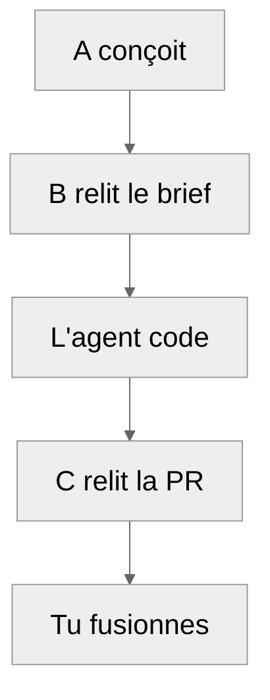

# Le workflow A/B/C expliqué

Cette page explique l'idée centrale du kit. Tu n'en as pas besoin pour le préréglage solo léger ou
groupe scolaire : elle sert quand tu génères l'espace IA.

## Le problème

Une IA qui écrit ton code et qui le relit dans la même conversation voit ce qu'elle a voulu faire,
pas ce qu'elle a fait. Elle répète ses propres erreurs avec assurance. Et une longue conversation
oublie : ses premiers échanges finissent résumés, avec leurs nuances en moins.

## La solution : séparer les rôles

Le workflow sépare celui qui conçoit, celui qui code et ceux qui relisent. Chacun travaille dans une
conversation neuve, et ne voit que ce dont il a besoin.

| Rôle | Ce qu'il fait | Ce qu'il voit |
|---|---|---|
| **A** (conception) | Discute avec toi, découpe le travail, écrit les briefs, arbitre | La conception et une copie du dépôt |
| **B** (relecture d'artefact) | Relit un brief ou un plan, avant le code | Le brief et ses pièces |
| **L'agent de code** | Écrit le code et les tests | Le dépôt et le brief du jalon |
| **C** (relecture de PR) | Relit le code fini, sans connaître la conception | Le code et ce que le brief promettait |
| **Toi** | Tranches les choix qui t'appartiennent, fusionnes | Tout |

Personne ne valide son propre travail. Tu gardes les décisions : ce que le projet doit faire, ce qui
entre dans `main`.

## Le cycle d'un jalon

Un **jalon** est une étape du projet, livrée en une pull request (PR).

1. **A conçoit.** Avec toi, A écrit le brief : ce que le jalon doit faire, et comment on saura qu'il
   le fait.
2. **B relit le brief.** Dans une conversation neuve, B cherche ce qui est faux ou impossible avant
   qu'une ligne de code existe. Corriger coûte alors peu.
3. **L'agent code.** Il propose un plan, tu le valides, il écrit le code et les tests, puis ouvre une PR.
4. **C relit la PR.** Sans avoir vu la conception, C compare le code à ce qui était promis.
5. **Tu fusionnes**, une fois les constats arbitrés par A et corrigés par l'agent.

## La frontière fait le travail

Le kit range les fichiers dans des dossiers séparés, et chaque rôle ne reçoit que les siens. Une
consigne (« ne lis pas ce fichier ») s'oublie ; un dossier auquel une conversation n'a pas accès, non.
Attention : un agent de code qui tourne sur ta machine peut souvent lire plus loin que son dossier.
Pour lui, la frontière est surtout une habitude, sauf si tu l'enfermes vraiment.

Donner accès à un dossier dépend de ton outil :

| Outil | Comment |
|---|---|
| Cowork | Connecter le dossier à la conversation |
| Claude Code | Choisir le dossier de la session. Il peut quand même lire toute la machine : seul un hook, ou un bac à sable comme bubblewrap sous WSL 2, l'en empêche vraiment. En pratique, il reste dans son dossier |
| Codex, Copilot, autre agent | Ouvrir l'agent dans le dossier |
| Conversation sans accès aux fichiers | Joindre les fichiers à la conversation |

## Passer la main sans rien perdre

Une conversation a une mémoire limitée. Quand elle se remplit, A écrit ce qu'il faut savoir dans
`CONTEXTE.md`, et une conversation neuve reprend à partir de ce fichier. C'est la **relève**.

L'état du projet vit donc dans des fichiers, pas dans une conversation. C'est ce qui permet de
reprendre un projet trois mois plus tard, ou de changer de modèle d'IA.

## Quand alléger

Tout ce cycle a un coût. Le kit propose donc des niveaux :

| Préréglage | Conversations |
|---|---|
| Solo léger, groupe scolaire | Aucune : le dépôt et un agent de code suffisent |
| Standard | A, B, C |
| Complet | A, B, C, plus les passes expertes et le test de mutation |

Pour un TP, le cycle complet serait excessif. Pour un projet qui dure, il évite des semaines de
corrections. Commence léger : un module s'ajoute plus tard ([guide](GUIDE.md#6-mettre-à-jour-un-projet)).

## Pour le détail

Une fois l'espace IA généré, `conception/kit/METHODE.md` donne les règles complètes, et
`conception/kit/VOCABULAIRE.md` définit chaque terme.
